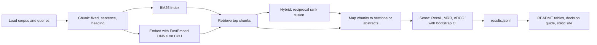

# cpu-rag-lab

[](https://github.com/shreyas-tech7/cpu-rag-lab/actions/workflows/ci.yml)

**Status:** release candidate v0.1.0-rc1. Every measured number below comes from `results/results.jsonl` and is written by `cpu-rag-lab report`.

<!-- BEGIN:status -->
Grid `default`: 90 of 90 runs done, 0 failed, 24.5 minutes of run time, peak RSS 1,416 MB. Run on 2026-11-20, Intel(R) Xeon(R) Processor @ 2.30GHz, 4 threads, bootstrap seed 0. Corpora: selfmade (91 docs, 574 queries), scifact1000 (1,000 docs, 300 queries).
<!-- END:status -->

## The problem

A small team or a hobbyist who wants local search over their own files has to pick a chunk size and a retriever. Most advice on that choice comes from GPU setups or from opinion. This lab runs one grid on a plain CPU, with fixed seeds, and reports quality with confidence intervals next to latency, memory and build time. Then it writes a decision guide from those numbers. Nothing in the loop calls an LLM, so a rerun costs nothing and gives the same scores.

## How it works



A watchdog thread reads resident memory from `/proc/self/status` and stops any run that goes over the 2 GB limit. The grid runner writes one JSON line per run and skips finished runs, so a stopped grid picks up where it left off.

## Results

Scores are means over queries. Brackets hold 95% percentile bootstrap intervals over queries (1000 resamples, seed 0). Latency is the time for one query on the machine in the status line. Peak RAM is the highest resident memory of the whole process during the run. BM25 runs go first, before the model is loaded. A hybrid run also carries the peak of the dense run whose vectors it reuses. The full table is in the [static site](docs/index.html) and the takeaways are in the [decision guide](docs/DECISION_GUIDE.md).

<!-- BEGIN:results -->
**self-made docs (fastapi, uv, httpx)**, top 5 of 54 runs by nDCG@10:

| # | Retriever | Chunker | Size (words) | Overlap | Recall@10 [95% CI] | MRR@10 [95% CI] | nDCG@10 [95% CI] | p50 ms | p95 ms | Peak RAM MB | Build s |
|---|---|---|---|---|---|---|---|---|---|---|---|
| 1 | hybrid (minilm) | heading | 512 | 0% | 0.845 [0.814, 0.873] | 0.540 [0.506, 0.574] | 0.614 [0.582, 0.645] | 1.83 | 2.93 | 1,340 | 54.62 |
| 2 | hybrid (minilm) | heading | 512 | 20% | 0.845 [0.814, 0.873] | 0.540 [0.506, 0.574] | 0.614 [0.582, 0.645] | 2.40 | 3.49 | 1,400 | 50.69 |
| 3 | hybrid (minilm) | heading | 256 | 0% | 0.842 [0.810, 0.869] | 0.540 [0.507, 0.574] | 0.613 [0.581, 0.643] | 1.97 | 2.70 | 1,340 | 55.97 |
| 4 | hybrid (minilm) | heading | 128 | 20% | 0.836 [0.805, 0.864] | 0.542 [0.507, 0.574] | 0.613 [0.581, 0.643] | 2.08 | 2.62 | 1,339 | 32.89 |
| 5 | hybrid (minilm) | heading | 256 | 20% | 0.843 [0.812, 0.871] | 0.539 [0.505, 0.572] | 0.613 [0.581, 0.641] | 2.48 | 3.55 | 1,340 | 47.23 |

The intervals of these five rows overlap, so treat them as a tie.

**SciFact, 1,000-abstract pool**, top 5 of 36 runs by nDCG@10:

| # | Retriever | Chunker | Size (words) | Overlap | Recall@10 [95% CI] | MRR@10 [95% CI] | nDCG@10 [95% CI] | p50 ms | p95 ms | Peak RAM MB | Build s |
|---|---|---|---|---|---|---|---|---|---|---|---|
| 1 | hybrid (minilm) | sentence | 512 | 0% | 0.908 [0.874, 0.940] | 0.800 [0.760, 0.841] | 0.822 [0.783, 0.857] | 3.50 | 4.98 | 1,415 | 59.41 |
| 2 | hybrid (minilm) | sentence | 512 | 20% | 0.908 [0.874, 0.940] | 0.800 [0.760, 0.841] | 0.822 [0.783, 0.857] | 3.54 | 5.16 | 1,415 | 59.87 |
| 3 | hybrid (minilm) | fixed | 512 | 0% | 0.908 [0.874, 0.940] | 0.799 [0.758, 0.839] | 0.820 [0.782, 0.856] | 3.23 | 4.89 | 1,416 | 58.63 |
| 4 | hybrid (minilm) | fixed | 512 | 20% | 0.908 [0.874, 0.940] | 0.799 [0.757, 0.838] | 0.820 [0.782, 0.856] | 3.82 | 5.26 | 1,416 | 58.43 |
| 5 | hybrid (minilm) | fixed | 256 | 20% | 0.898 [0.863, 0.930] | 0.803 [0.760, 0.844] | 0.820 [0.781, 0.857] | 14.84 | 23.91 | 1,415 | 73.65 |

The intervals of these five rows overlap, so treat them as a tie.
<!-- END:results -->

### Models

<!-- BEGIN:models -->
| Model | Kind | Size MB | License | Pinned revision |
|---|---|---|---|---|
| `hash`  | hash | 0 | MIT (this repo) | built in |
| `minilm` sentence-transformers/all-MiniLM-L6-v2 | fastembed | 86.2 | Apache-2.0 | Chroma ONNX export onnx.tar.gz, archive sha256 913d7300ceae (file dated 2023-03-30), model.onnx sha256 `4f148ba8ae9c2c7f` |

Hashes are shortened here. The full SHA-256 values are in `models.json`.

Blocked on the build machine:

- `BAAI/bge-small-en-v1.5`: FastEmbed 0.9.1 downloads it only from huggingface.co, which answered 403 on 2026-11-20. The old Google Cloud Storage mirror answered 403 AccessDenied.
- `cross-encoder reranker`: Every FastEmbed cross-encoder ONNX file lives on huggingface.co, which is blocked. The optional reranker is off.
<!-- END:models -->

## Cost per task

Every run is local. No API is called, so the money cost per query is zero. The cost that matters is CPU time and memory. The table gives the median over all runs of each retriever.

<!-- BEGIN:cost -->
| Corpus | Retriever | Median build s | Median p50 ms per query | Median peak RAM MB |
|---|---|---|---|---|
| selfmade | bm25 | 0.04 | 0.03 | 51 |
| selfmade | dense | 33.17 | 1.86 | 1,359 |
| selfmade | hybrid | 33.22 | 2.04 | 1,359 |
| scifact1000 | bm25 | 0.18 | 0.07 | 86 |
| scifact1000 | dense | 61.89 | 8.09 | 1,415 |
| scifact1000 | hybrid | 62.13 | 11.87 | 1,415 |
<!-- END:cost -->

## Run it in 10 minutes

You need Python 3.11 or newer.

```bash
git clone https://github.com/shreyas-tech7/cpu-rag-lab.git
cd cpu-rag-lab
./init.sh                                    # venv, install, lint, all tests offline
.venv/bin/cpu-rag-lab run --config configs/tiny.json   # tiny grid, hash embedder, under a second
.venv/bin/cpu-rag-lab status --config configs/tiny.json
```

To rerun the real grid, fetch the data and the model once. Every download is checked against a pinned SHA-256.

```bash
uv pip install --python .venv/bin/python -e ".[dense]"
.venv/bin/python scripts/fetch_data.py scifact models
taskset -c 0-3 .venv/bin/cpu-rag-lab run --config configs/default.json --results results/my-run.jsonl
.venv/bin/cpu-rag-lab report --results results/my-run.jsonl
```

The status line shows how long the default grid took on a 4-core VM. If it stops, run the same command again and it resumes. Open `docs/index.html` straight from disk to browse every run.

## Limits

- **Proxy queries.** Queries for the self-made corpus are section headings, and the section under each heading is the right answer. Headings are short and use the same words as the docs, which favors BM25. They show which settings find a named section. They do not show how a real user's question would fare.
- **Smaller SciFact pool.** The default grid uses part of the SciFact corpus: every cited abstract plus random others drawn with seed 0. The status line gives the pool size. A smaller pool is an easier task, so these scores sit above published full-pool SciFact numbers.
- **One real embedding model.** Hugging Face is blocked on the build machine, so only all-MiniLM-L6-v2 could be fetched. The brief's default, bge-small-en-v1.5, is not in these results. The reranker is off for the same reason.
- **Words, not tokens.** Chunk size counts words split on spaces. MiniLM reads at most 256 tokens, so the longest chunks are cut short for dense search, while BM25 sees all of each chunk.
- **Uneven dense latency on SciFact.** Dense query latency on the SciFact pool jumps in steps when the chunk count grows, which a dot product cannot explain. It looks like thread contention between numpy and ONNX Runtime on the build VM. That is an inference. Read those latencies as a property of the machine.
- **One machine.** Latency and build time come from one 4-core cloud VM. Expect other numbers on other hardware. The ranking of settings should move less than the raw times.
- **Chunks that span sections.** A retrieved chunk gives credit to every section its words come from. A long fixed or sentence chunk can span several short sections, while a heading chunk spans one. This favors long chunks a little, and it favors heading chunks on the self-made corpus.
- **Intervals cover query sampling only.** They do not cover other corpora, other models or timing noise.

## Glossary

- **Chunk:** a piece of a document that gets indexed and returned on its own.
- **BM25:** a word-matching score. It rewards rare query words that appear often in a chunk, with a penalty for long chunks.
- **Dense search:** turn text into vectors with an embedding model, then return the chunks whose vectors point closest to the query's vector.
- **Hybrid search:** run BM25 and dense search, then merge the two ranked lists.
- **Reciprocal rank fusion (RRF):** a way to merge ranked lists. Each chunk scores the sum of 1 / (60 + rank) over the lists. It needs no common score scale.
- **Recall@k:** the share of right answers found in the top k.
- **MRR@10:** the mean of 1 / rank of the first right answer, counting only the top 10.
- **nDCG@10:** a top-10 score that gives more credit for right answers near the top.
- **Bootstrap interval:** resample the queries with replacement many times and take the middle 95% of the means.
- **p50 and p95:** the median and the 95th percentile of per-query latency.
- **RSS:** resident set size, the memory the process holds in RAM.

## Related work

Several projects already benchmark retrieval for RAG. [BERGEN](https://arxiv.org/html/2407.01102v1) standardizes RAG experiments. [RAGPerf](https://arxiv.org/abs/2603.10765) studies RAG system performance. [EncouRAGe](https://arxiv.org/html/2511.04696v1) found that reranking gave small gains at higher latency. [RAGe](https://www.alphaxiv.org/abs/2605.27445) compares chunking, vector databases, embedding models and retrievers and ties quality to hardware limits. [BEIR](https://github.com/beir-cellar/beir) is the standard zero-shot retrieval benchmark and the source of the SciFact split used here. This repo does not claim to be first. It offers a free grid that anyone can rerun on a CPU, with intervals, memory and latency in one table.

## How this was built

AI agents wrote most of the code under Shreyas's direction. The full build brief is in [docs/build/BUILD_PROMPT.md](docs/build/BUILD_PROMPT.md). Choices are logged in [DECISIONS.md](DECISIONS.md) and failures in [BLOCKERS.md](BLOCKERS.md).

Human checks, not done yet:

- Shreyas has not yet read the diff or reviewed the results.
- Shreyas has not yet rerun the grid on his own machine.
- Shreyas has not yet checked the model and dataset licenses by hand.

Data credits: SciFact by Wadden et al. (CC BY-NC 2.0). Self-made corpus from the docs of [FastAPI](https://github.com/fastapi/fastapi) (MIT), [uv](https://github.com/astral-sh/uv) (MIT or Apache-2.0) and [HTTPX](https://github.com/encode/httpx) (BSD-3-Clause), with license files in `data/selfmade/licenses/`. Model all-MiniLM-L6-v2 (Apache-2.0) by the sentence-transformers team, ONNX export hosted by Chroma.

License: [MIT](LICENSE).
